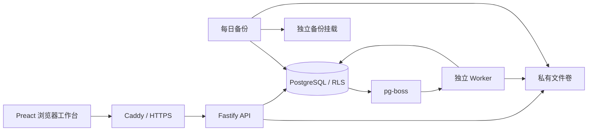

# 设计与边界

## 保留原工作台，新增团队能力

团队前端直接复用 `src/finance-dashboard.jsx` 及原版样式、25 个完整工作流和任务要求组件。仅在团队构建时把本机存储模块替换成 `web/server-store.ts`；个人插件仍使用原本的存储实现。

| 原版能力 | 团队版承接方式 |
|---|---|
| 收入、应收、应付、费用、资金、预算、资产、税务、发票、工资、对账、成本、报表、分析、投资等模块 | 复用原页面、专业规则、处理链路和工作流推荐 |
| 经营总览、汇总指标、近六期趋势 | 按公司、期间保存快照，读取同公司历史期间 |
| 待办、月结清单、异常台账 | 服务端存储、乐观版本检查、业务审计；不等同于系统交付审批 |
| 文件上传、文件夹上传、搜索、类型和目录筛选、排序、引用、置顶、下载 | 对接本公司本期私有文件索引与鉴权下载，保留版本 |
| 25 个工作流、完整提示词、任务要求、收藏、最近使用 | 原组件保留；执行改为持久化任务包下载与成果回传 |
| 四套主题与个人收藏 | 按账号保存在服务器 |
| 字段字典、关键阈值 | 按公司与期间保存，禁止改写已归档月份 |
| 本机日志、JSON 备份 | 团队版替换为不可修改的服务端审计、完整运维备份与受控历史导入；冲突草稿可导出 |
| 新增团队页面 | 客户公司、月度交付、审核中心、员工、导入、后台任务、运行与备份 |

公司切换先等待待保存请求完成，再卸载旧页面并清空文件与选择。保存失败或版本冲突会显示提示，保留当前草稿；不能静默覆盖其他同事。原插件与团队版不共用浏览器业务存储。

## 服务与数据

`core.ts` 负责身份上下文、事务、授权、版本检查、摘要和文件操作；`server.ts` 提供账号、公司、月度流程、文件与任务动作；`workspace.ts` 承接原版业务页面；`tables.ts` 负责确定性表格校验和唯一匹配；`worker.ts` 执行批量生成、导入和导出；`admin.ts` 只在迁移及首次初始化容器使用管理账号。

公司业务携带 org_id/company_id。运行账号 zy_app 不是业务表所有者，没有超级用户或 BYPASSRLS。每个事务设置服务端认证得到的用户编号，RLS 再检查机构与当前公司授权。列表、文件、工作单、历史记录、任务和工作台状态使用同一边界。zy_queue 只拥有队列结构及必要的派发函数，不拥有业务表，也不读取密码摘要。

RLS 用于防止应用查询漏写公司条件；它不是任意 SQL 执行漏洞的完整防御。所有业务参数继续使用参数化 SQL，客户端无法提供登录身份。

## 文件与审核

文件存储路径为机构 / 公司 / source、result 或 evidence / 随机编号；原始名只保存在索引中。下载统一 attachment，校验 SHA-256，不直接公开存储路径。兼容早期测试版本的随机路径索引。

原件与成果不可覆盖；新上传生成版本。处理期间更换已回传成果、提交复核后更换成果，会使当前检查或审批失效。归档禁止修改，只有重开后才允许新版本。业务数据与审计共同提交，审计表和审核快照禁止运行账号更新、删除。

独立复核检查当前经办、历次经办贡献者和提交人，负责人也不豁免。审批保存具体文件编号、摘要和版本。历史导入、月结打勾、复制提示词、系统生成任务包都不能充当交付审批或客户交付证据。

## API

基础前缀 `/api/v1`。登录后访问 `/api/v1/openapi.json` 查看自动生成文档。写操作使用服务端会话 Cookie 和 `x-csrf-token`，浏览器来源必须匹配 APP_ORIGIN。没有公开注册、任意修改状态或自动向客户发消息的接口。

| 路由组 | 功能 |
|---|---|
| `/auth/login`、`/auth/me`、`/auth/password`、`/auth/logout` | 登录、强制改密、会话撤销 |
| `/users`、`/users/:id/reset-password` | 员工启停、角色、密码重置 |
| `/companies`、`/:id/members`、`/:id/template` | 客户、授权、未来月份模板 |
| `/companies/:id/workspace/:period` | 原版业务状态读取、按 key 更新，写入必须带 version |
| `/companies/:id/files?period=YYYY-MM` | 授权公司的本期资料库 |
| `/orders`、`/:id/material`、`/:id/assign`、`/:id/action` | 月度创建、资料、分工和受控流转 |
| `/orders/:id/files`、`/files/:id/download` | 私有附件上传与下载 |
| `/orders/:id/runs`、`/runs/:id/return` | 显式 WorkBuddy 执行及回传 |
| `/imports/preview`、`/imports/legacy/preview`、`/reconcile` | 先预览再确认与唯一核对 |
| `/jobs`、`/:id/retry`、`/:id/download` | 幂等后台任务、有限重试和下载 |
| `/audit`、`/admin/health`、`/preferences/desk` | 审计、运维与个人设置 |

业务更新必须提交读取时的版本。409 表示状态冲突或数据已改变，应刷新核对后重试。批量及导入用稳定请求 key；同 key 不能换内容。Worker 每次按当前员工状态和公司授权重新检查，撤权后任务不能继续读取该公司。

## 明确的首版边界

- 单机构启用，合成测试使用两个及以上机构验证边界；没有开放多机构注册。
- WorkBuddy 显式下载、回传，不依赖未经验证的回调；回传的结构检查不等同于财税判断。
- 原版模块中的专业步骤和提示词仍是辅助工作流，不变成自动记账、报税或付款程序。
- CSV/XLSX 格式校验和标准唯一核对可自动执行；PDF、图片保存原件，不做 OCR、验真、杀毒或专业结论承诺。
- 单文件 50MB，表格 10MB/10000 行/100 列，单任务包输入合计 200MB；资料库一次最多读取 1000 条本期索引。
- 单机、默认本机访问；正式共享需 HTTPS，异机备份需按运维说明另行配置。
